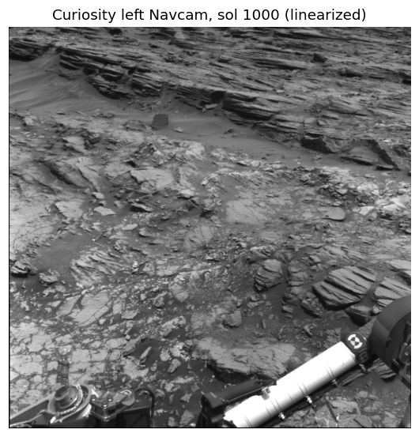
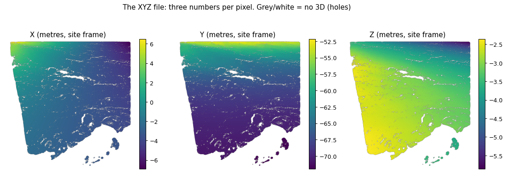
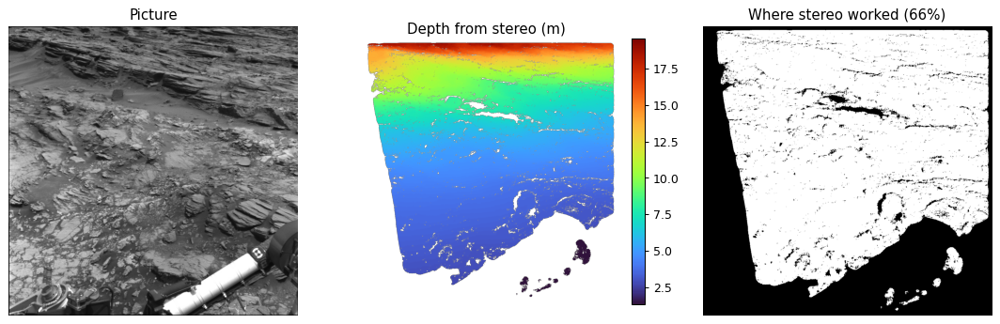
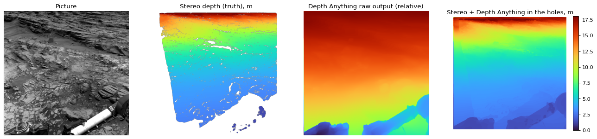
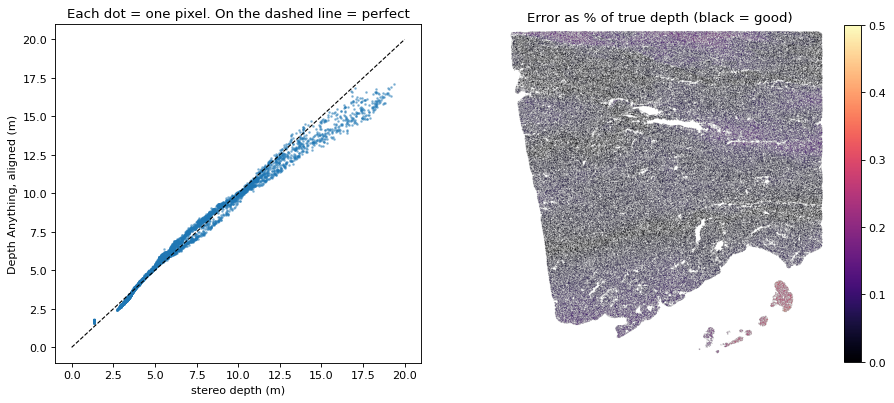
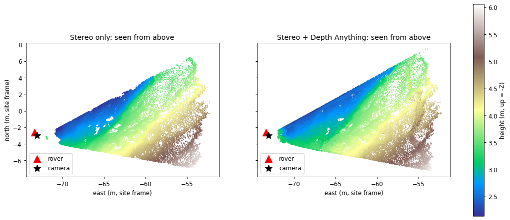
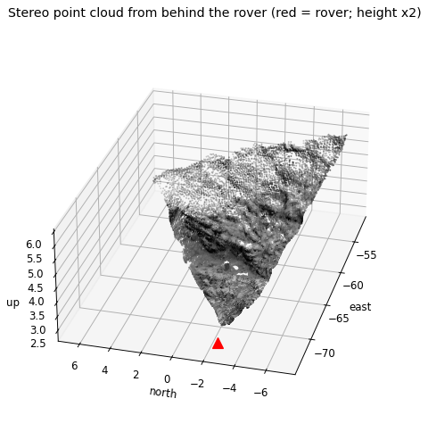

# Learn the 3D pipeline from zero

For Sohaib, Khizra and Izza. Written 18 Oct 2026. Every number below comes from running the lab on a
real Curiosity image (sol 1000, 30 May 2015).

**How to use this:** read the lessons in order. After lessons 4, 8 and 10, run the matching
script and look at the figure it makes:

```
cd learn-3d/lab
python3 01_look_at_the_data.py     # lessons 1 to 6
python3 02_depth_anything.py       # lessons 7 to 9
python3 03_depth_to_3d.py          # lessons 10 and 11
```

### See it run


| What                              | Where                                                                                                              | What you'll see                                                                                                                                     |
| --------------------------------- | ------------------------------------------------------------------------------------------------------------------ | --------------------------------------------------------------------------------------------------------------------------------------------------- |
| **Notebook 1: from photo to 3D**  | `notebooks/01_photo_to_3d.ipynb`                                                                                   | Every lesson below as one cell each, run on the real photo, with the outputs saved under each cell (numbers, depth maps, a 3D cloud you can rotate) |
| **Notebook 2: fine-tune or not?** | `notebooks/02_finetune_or_not.ipynb`                                                                               | Trains Depth Anything on two Curiosity sites, tests on a third, and compares it with the no-training version                                        |
| **POC: Sol 1100 Terrain Model**   | `poc/site/`, live at https://claude.ai/artifact/PtU4f1Yz13zL2cqHNoxFWH (rebuild with `python3 poc/build_scene.py`) | A full 19-frame panorama as 3D ground you can rotate, colour by photo, height or walking slope, and click to measure                                |

**Free GPU from VS Code (Google Colab extension, already installed):**

1. Open a notebook.
2. Click **Select Kernel** (top right) → **Colab** → **New Colab Server**.
3. Choose **T4 GPU** and sign in with Google.
4. Click **Run All**.

The notebooks download their own data, so they work on Colab as they are. On Kaggle (30 free GPU hours a week), upload the
`.ipynb`, turn on **Internet** and **GPU T4** in the notebook settings, and run it.

> **Rules note.** This is learning material made with one sample image. It isn't project code.
> Keep it out of the team repo. On Sat 14 Nov, write the real pipeline fresh. Lesson 13 has the
> weekend plan.

---


> In this repo: the step-by-step lab is `notebooks/01_photo_to_3d.ipynb` (outputs saved), the fine-tuning test is `notebooks/02_finetune_or_not.ipynb`, and the multi-stop pipeline is `navcam3d/`.

## 0. The plan, translated

Khizra's summary, one step at a time, with what each step really means:


| Step in the WhatsApp message                                                                          | Plain meaning                                                                 | Lesson    |
| ----------------------------------------------------------------------------------------------------- | ----------------------------------------------------------------------------- | --------- |
| "Use Curiosity Navcam images and their stereo XYZ data"                                               | Download photos plus a file that gives the real 3D position of every pixel    | 1, 2, 3   |
| "Map the XYZ data to the images to obtain depth"                                                      | For each pixel, work out how far in front of the camera that point is         | 4, 5      |
| "Use the pretrained Depth Anything V2 model to estimate depth"                                        | An AI that guesses depth from a single photo                                  | 7, 8      |
| "Fine-tune it on Mars images and stereo depth"                                                        | Extra training so it guesses Mars depth better                                | 9         |
| "Use predicted depth maps with camera and rover positioning data to reconstruct and align 3D terrain" | Turn depth back into 3D points, join them into a surface, place it on the map | 6, 10, 11 |

```
 photo ──► Depth Anything ──► depth map ──┐
   │                                      ├──► 3D points ──► mesh ──► placed on the Mars map
 stereo XYZ ──► "true" depth ─────────────┘        ▲                       ▲
   (used to scale or train the AI)         camera model            rover position
```

---

## 1. What a photo is to a computer

A photo is a grid of numbers. Our Navcam photo is **1024 × 1024 pixels**, black and white, and
each pixel holds a brightness from 0 to 4095 (12-bit). Row = "line", column = "sample".



Curiosity has two Navcams side by side on its mast, about 2 m above the ground, like two eyes.
Each sees a 45° field of view.

## 2. How two eyes give depth (stereo)

Hold a finger in front of your face and close each eye in turn. The finger "jumps" a lot. A
far-away wall barely moves. That jump is called **disparity**, and it's how stereo works:

```
   left cam        right cam
      o<── B = 42.4 cm ──>o          Z = f × B / d
       \                 /            Z = depth (m)
        \               /             f = focal length (pixels)
         \             /              B = baseline, the gap between the cameras
          \           /               d = disparity, how many pixels the point shifted
           \         /
            \       /                 near point → big d → easy to measure
             \     /                  far point → tiny d → small errors become big depth errors
              \   /
               \ /
                *  point on the ground
```

NASA's image-processing team (MIPL) matches every pixel of the left photo to the right photo,
measures the shift, and computes the 3D point. Stereo leaves **holes** where:

- only one camera sees that spot (the left strip of our photo),
- the surface has no texture to match, or is hidden behind a rock,
- it's too far away for the shift to be measured reliably,
- it's the rover itself (the arm, bottom right).

## 3. The XYZ file

For every pixel of the left photo, the XYZ file stores **three numbers: the X, Y and Z
position in metres** of the spot that pixel sees. If stereo failed, it stores (0, 0, 0).



Our sample: **66% of pixels have 3D**, from **1.3 m to 19.6 m** away (median 5.4 m).

There's also an **RNG** (range) file: the straight-line distance from the camera to each point.

**Decoding a file name**, `NLB_486270860XYZLF0481570NCAM00323M1`:


| Part        | Meaning                                                                            |
| ----------- | ---------------------------------------------------------------------------------- |
| `N` `L` `B` | Navcam, Left eye, rover computer B                                                 |
| `486270860` | spacecraft clock: when the photo was taken                                         |
| `XYZ`       | product type (`RAS` = the photo, `RNG` = range, `UVW` = surface normals, and more) |
| `L` `F`     | <br />Linearized (lens distortion removed), Full frame                             |
| `0481570`   | site 48, drive 1570: where the rover was (lesson 6)                                |
| `NCAM00323` | the command sequence that took it                                                  |

Where to get them: NASA's archive at `planetarydata.jpl.nasa.gov/img/data/msl/MSLNAV_1XXX/`
(`DATA_V1/SOLnnnnn/` for sols 1 to 1869, `DATA/` after that). Every `.IMG` file has a `.LBL` text
label that describes it. Open one in a text editor; it's readable.

## 4. The camera model (the "camera calibration" in the message)

To go between 3D points and pixels, you need to know exactly where the camera is, where it points
and how its lens works. JPL describes this with four vectors called **CAHV**, written in the
label:


| Vector | Meaning                                                                                       |
| ------ | --------------------------------------------------------------------------------------------- |
| **C**  | Centre: where the camera is (metres)                                                          |
| **A**  | Axis: the direction it points                                                                 |
| **H**  | Horizontal: turns a 3D direction into a pixel column (focal length and image centre built in) |
| **V**  | Vertical: the same for the pixel row                                                          |

```
pixel column = (P − C)·H / (P − C)·A
pixel row    = (P − C)·V / (P − C)·A        P = a 3D point, "·" = dot product
```

The raw photos have lens distortion and need a more complicated model (CAHVOR). The
**linearized** (`L`) products have the distortion removed, so plain CAHV works. Use `L` files.

**Check from the lab:** projecting every XYZ point back through CAHV lands it **0.10 pixel**
from its own pixel. So the XYZ file really is lined up pixel for pixel with the photo.

## 5. Depth vs range vs XYZ ("map the XYZ data to the images")

- **XYZ:** the 3D point itself.
- **Range:** the straight-line distance, |P − C|.
- **Depth:** the distance along the camera's pointing axis, (P − C)·A. This is what depth maps
  and Depth Anything use.

So Khizra's step 2 is **one line of maths per pixel**: depth = (P − C)·A. Because the XYZ file is
already aligned with the photo, there's no matching to do. The result is a depth map (middle
panel below) with holes (right panel).



## 6. Coordinate frames ("rover positioning data")

The same point has different coordinates depending on where you measure from.


| Frame           | Origin                                                                            | Axes                          |
| --------------- | --------------------------------------------------------------------------------- | ----------------------------- |
| **Rover frame** | On the rover; moves with it                                                       | X forward, Y right,**Z down** |
| **Site frame**  | Fixed on the ground; a new "site" is declared every so often as the rover travels | X north, Y east,**Z down**    |

**Z points down**, so height = −Z. People get this wrong all the time.

The label stores where the rover stood in the site frame: an **offset** (position, metres) and a
**quaternion** (a compact way to write a rotation, scalar first). Together they give:

```
p_site = R × p_rover + t
```

R is the rotation matrix built from the quaternion; t is the offset. The camera model is written
in the rover frame, and the XYZ file in the site frame, so this formula connects them.

**Check from the lab:** the camera centre converted into the site frame matches the range origin
NASA wrote in the RNG label **to the millimetre**, (−2.977, −73.049, −4.443) m.

Every image taken at the same site shares one frame, so their 3D points line up automatically.
To place a site on the Mars map (latitude, longitude, elevation, on top of HiRISE orbital
images), you need the **rover localization table** that the MSL team publishes. Finding that
exact file is a to-do; the PDS Geosciences Node is the place to look.

## 7. Depth from ONE photo: Depth Anything V2

Humans judge depth with one eye closed by using clues: things get smaller, textures get finer,
near objects hide far ones, the ground rises toward the horizon. A neural network can learn the
same clues.

**Depth Anything V2** (2024):

- A large "teacher" model was trained on 595,000 synthetic images with perfect depth.
- It then labelled 62 million real photos, and smaller "student" models learned from those labels.
- Inside: a vision transformer (DINOv2) that understands the image, plus a decoder (DPT) that
  paints a depth value for every pixel.


| Size      | Parameters | Licence                               |
| --------- | ---------- | ------------------------------------- |
| **Small** | 25 M       | **Apache-2.0** (free to use anywhere) |
| Base      | 98 M       | CC-BY-NC-4.0 (non-commercial only)    |
| Large     | 335 M      | CC-BY-NC-4.0                          |

The catch: its output is **relative**. Bigger numbers mean closer, but there are **no units**.
It knows the rock is closer than the hill, not that the rock is 3.2 m away. In maths terms the
output is inverse depth with an unknown **scale** and **shift**. (Separate "metric" versions
exist, but they were tuned on indoor and Earth driving scenes.)

## 8. Giving it units: scale-and-shift alignment

If you know the true depth at some pixels (from stereo), find the two numbers s and t that make

```
s × (model output) + t  ≈  1 / true depth
```

as close as possible over those pixels. That's ordinary least squares, the same maths as fitting
a straight line through points. Then depth = 1 / (s × output + t) for every pixel, including the
holes.

**Lab results** (graded only on pixels the fit never saw; "AbsRel" = average error as a
percentage of the true depth):


| How it was aligned                        | Average error | Within 25% of truth | Median error |
| ----------------------------------------- | ------------- | ------------------- | ------------ |
| Using half the stereo pixels              | **4.9%**      | 99.2%               | 0.22 m       |
| Using only**200** stereo pixels           | **5.1%**      | 99.8%               | 0.25 m       |
| Fit on near (<8 m), tested on far (≥8 m) | 7.7%          | 98.3%               | 0.69 m       |


| Distance   | Average error | Median error |
| ---------- | ------------- | ------------ |
| 0 to 4 m   | 5.4%          | 0.16 m       |
| 4 to 8 m   | 4.9%          | 0.23 m       |
| 8 to 12 m  | 2.8%          | 0.23 m       |
| 12 to 20 m | 7.1%          | 0.98 m       |




**What this shows:** with **no training at all**, Depth Anything Small plus 200 stereo points
is within about 5% of stereo. Stereo covers 66% of the picture; stereo plus Depth Anything covers
100%. The weak spot is beyond about 12 m, where it underestimates distance (the dots bend below
the dashed line). It also happily predicts depth for the rover's arm, which you have to mask out.

This is one image of one kind of terrain, so test more images before trusting it.

**What the 19-frame panorama added (sol 1100, the POC):** photos aimed down at the ground were just as
good (0.7 to 3% error). But photos aimed at the horizon see ground from 2 m out to 60 m and beyond, and a single
straight-line fit broke on them, with errors up to **75%**. The fix needed no training. Try three ways of
scaling each photo, then keep the one that scores best on a few stereo pixels set aside for checking:


| Fit      | What it assumes                                           | Good at                                |
| -------- | --------------------------------------------------------- | -------------------------------------- |
| plain    | 1/depth = s × output + t                                 | photos of nearby ground                |
| weighted | the same, but scored by % error                           | mixed scenes                           |
| power    | depth = a × output^k (a straight line on a log-log plot) | near ground and far hills in one photo |

Choosing the fit per photo cut the worst frame from 75% to **13%**, and the median from 6.0% to **5.2%**.
How you scale the output matters as much as the model.

## 9. Fine-tuning: what it would mean

Fine-tuning = keep training the model on your own examples, so it adapts to Mars.

- **Training pairs:** (Navcam photo, stereo depth map, a "valid" mask for where stereo
  worked). The archive has thousands.
- **Loss** (the score training tries to lower): a scale-and-shift-invariant loss, which compares
  the *shape* of the depth map, or a "SILog" loss if you want real metres out.
- **Usually** freeze the encoder (the part that understands images) and train only the decoder,
  with a small learning rate, so you don't destroy what it already knows.
- **Split by site, never randomly.** Neighbouring Navcam photos overlap. Random splits leak test
  pictures into training and give fake good scores.
- **Compute:** Small fits on a free Colab or Kaggle T4 GPU. Your laptop's 4 GB GPU can *run* it
  (lesson 2 did) but is too small to train comfortably.
- **The bar to beat:** zero-shot plus alignment already gives about 5%. Fine-tuning is only
  worth it if it clearly beats that on held-out sites, especially the 12 to 20 m band and images
  with **no** stereo partner.

## 10. From depth back to 3D

Each pixel defines a **ray**: a line from the camera centre through that pixel into the world
(computed from CAHV). Walk along the ray until you're `depth` metres in front of the camera, and
that's the 3D point:

```
point_rover = C + ray × depth / (ray·A)
point_site  = R × point_rover + t
```

**Check from the lab:** doing this with the stereo depth rebuilds NASA's own XYZ file to a median
of **0.5 mm**. The maths is right.

A pile of 3D points is a **point cloud**: 693,248 points from stereo, and 1,021,508 with the
Depth Anything holes filled.

## 11. From points to a surface (mesh) and onto the map

A **mesh** is the points joined into small triangles so it looks like a solid surface. Because
the points come from an image grid, it's easy: join each pixel to its right and lower
neighbours. **Don't join across a big depth jump**, or a rock gets glued to the ground behind it.
The lab mesh has 63,876 corners and 121,366 triangles (using every 4th pixel).

Seen from above, in the site frame, this is the view a route planner needs. The camera's view
fans out from the rover, and the ground rises about 4 m toward the rock outcrop:




Files in `3d/` (`.ply` is a simple 3D format): `stereo_points.ply`,
`stereo_plus_da_points.ply`, `terrain_mesh.ply`. Open them in MeshLab or Blender, or drag them
into https://3dviewer.net (it runs in your browser; nothing is uploaded).

## 12. What this means for our plan

1. Steps 1, 2 and 5 of the plan (data → depth → 3D → mesh → site frame) **work exactly as
   described**. The lab did each one and checked it against NASA's own numbers.
2. **Step 4 (fine-tuning) is optional, not the core.** Do "stereo-anchored Depth Anything" first:

   - use stereo where it exists,
   - align Depth Anything per image using the stereo pixels,
   - use it to fill holes and extend range.

   That's no training, about a minute per image, and it gave about 5% error. Fine-tuning becomes
   a stretch goal for the far range.
3. **Mask the rover** (arm, wheels, deck) before filling holes.
4. **Use Depth Anything V2 Small** (Apache-2.0). Base and Large are non-commercial only.
5. **The scale mismatch is still the big one.** One Navcam view covers about 20 m. A Marswalk
   covers kilometres. The route itself needs orbital terrain (HiRISE or CTX DTMs). The Navcam
   meshes become 3D close-ups at the stops along the route, which is still a strong demo feature.
6. Still to find: the localization table that puts each site on the global map (lesson 6).

## 13. Who does what on the weekend (suggestion)


| Person | Sat 14 Nov                                                             | Sun 15 Nov                                                         |
| ------ | ---------------------------------------------------------------------- | ------------------------------------------------------------------ |
| Sohaib | Download pipeline + XYZ/depth/frames code for the chosen route's sites | Depth → mesh → glTF for the web viewer; help integrate           |
| Khizra | Depth Anything + alignment + rover mask; test on 20+ images            | Stretch goal: quick fine-tune on Colab if alignment fails at range |
| Izza   | Pick the sites along the route; localization to the global map         | Check accuracy numbers; slides on method and limits                |

## 14. Glossary


| Word                      | Meaning                                                                                 |
| ------------------------- | --------------------------------------------------------------------------------------- |
| Navcam                    | Curiosity's black-and-white navigation cameras, a stereo pair on the mast               |
| Sol                       | A Mars day; sol 1000 = Curiosity's 1000th day                                           |
| Stereo                    | Getting depth from two cameras a known distance apart                                   |
| Disparity                 | How far a point shifts between the left and right image                                 |
| Baseline                  | The distance between the two cameras (42.4 cm on Navcam)                                |
| XYZ / RNG product         | NASA files with the 3D point / distance for every pixel                                 |
| Linearized                | Image with lens distortion removed                                                      |
| CAHV                      | JPL's camera model: Centre, Axis, Horizontal, Vertical                                  |
| Depth map                 | An image whose pixel values are distances                                               |
| Relative vs metric depth  | Ordering only (near/far) vs real metres                                                 |
| Scale and shift alignment | Fitting two numbers that turn relative depth into metres                                |
| Fine-tuning               | Extra training of a pretrained model on your own data                                   |
| Encoder / decoder         | The part that understands the image / the part that paints the output                   |
| Point cloud               | A set of 3D points                                                                      |
| Mesh                      | Points joined into triangles to form a surface                                          |
| PLY / glTF                | 3D file formats (PLY is simple; glTF is what web 3D viewers load)                       |
| Rover frame / site frame  | Coordinates attached to the rover / to a fixed spot on the ground                       |
| Quaternion                | Four numbers that describe a rotation                                                   |
| DTM                       | Digital Terrain Model: a height map, here from orbit (HiRISE about 1 m, CTX about 20 m) |
| AbsRel, δ<1.25           | Standard depth-error scores: average % error; % of pixels within 25%                    |
